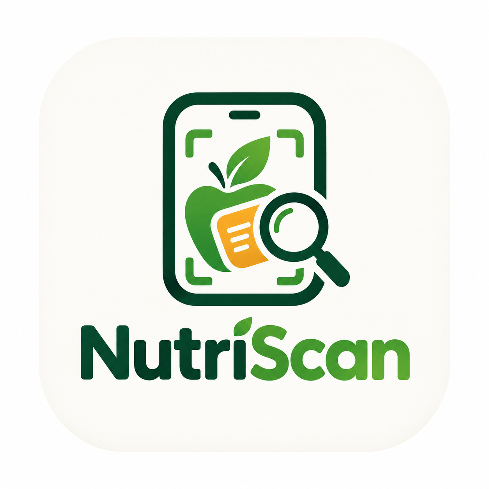

# NutriScan



**NutriScan is a bilingual English/Bangla mobile label-guide prototype for Bangladesh retail products.** It helps people scan or look up a product, inspect label-oriented information, compare selected food alternatives, and browse a growing local product catalog.

> **Prototype notice:** NutriScan is a demonstration application. Product scores, nutrition quantities, ingredient notes, package renders and selected evidence states are prototype values. They are not medical advice, laboratory results, halal certification, official product assessments or a substitute for reading the current package label.

## What the app does

NutriScan is organized around a scan-first experience:

- Scan a barcode with the native Expo camera flow.
- Enter a barcode manually when a camera is unavailable.
- Use a web-only mock camera in Expo Web Preview to exercise the scanner interface without native camera hardware.
- Open product details with category-aware layouts for food, personal care and home care.
- Browse local products through Discover with search, category filters and product cards.
- Review recent scans and locally saved favorites.
- Compare food products through **Better Alternatives**, which matches the same product family and only suggests higher-scoring records above the configured threshold.
- Enable **Halal Mode** to show only catalog records with linked halal evidence in the prototype data model.
- Read bilingual label ingredients, evidence notes, usage guidance and safety-oriented reminders.
- Contribute a local product draft with optional photo and barcode information. Contribution data remains local in this prototype and is not submitted to a review service.
- Switch between English and Bangla and use the light/dark appearance preference.

## Catalog coverage

The catalog currently contains Bangladesh-focused food, personal-care and home-care examples.

### Food

The prototype includes familiar local-market examples such as PRAN Frooto Mango Drink, PRAN Mr. Noodles Spicy Tomato, Bombay Sweets Potato Crackers, Olympic snacks, Radhuni Chilli Powder and Ispahani Mirzapore Tea. It also includes same-family prototype alternatives for mango drinks, instant noodles and potato snacks.

Food records can include a transparent prototype score, nutrition rows, factors, ingredient explanations and Better Alternatives. A food score should never be interpreted as a validated nutrition standard.

### Personal care

The catalog includes:

- Meril Petroleum Jelly
- Keya Beauty Soap
- Lux Soft Touch Beauty Soap
- Sunsilk Black Shine Shampoo
- Dettol Original Handwash

Personal-care records intentionally use an **evidence summary** rather than a food-style health score. Their details focus on ingredient disclosure, variant context, directions and product-label verification.

### Home care

The catalog includes:

- Vim Dishwashing Liquid
- Wheel Washing Powder
- Rin Power Bright Detergent
- Harpic Power Plus Toilet Cleaner
- ACI Aerosol Insect Killer

Home-care records use a **use-label summary** with directions, precautions and verification notes. Cleaning products should always be used according to the current package instructions and should never be mixed unless the package explicitly says it is safe.

## Main screens

| Route | Purpose |
|---|---|
| `/` | Scan-first Home screen with catalog highlights, categories and the looping scan illustration |
| `/scan` | Native camera scanner, manual barcode lookup and web mock-camera mode |
| `/discover` | Searchable catalog with Food, Personal care and Home care filters |
| `/history` | Recent scans and locally saved product history |
| `/more` | Halal Mode, favorites and utility navigation |
| `/product/:id` | Product details, label information, evidence, ingredients and actions |
| `/profile` | Local profile/preferences flow |
| `/contribute` | Local product-contribution draft form |
| `/community` | Community information and contribution entry point |
| `/support` | Support and app-help information |
| `/nutrifacts` | General label and nutrition education content |

## Technology stack

- **Expo SDK 57** and **React Native 0.86**
- **Expo Router** for file-based navigation
- **React 19** and **TypeScript**
- **React Native Web** for the browser preview
- **Expo Camera** for native barcode scanning
- **AsyncStorage** for local preferences, favorites, scan history and contribution drafts
- **TanStack Query** and **tRPC** for the application/server boundary
- **Express**, `tsx` and `esbuild` for the server runtime
- **Drizzle ORM** with MySQL support for the database schema and migrations
- **Vitest** for tests
- **Noto Sans Bengali** for bilingual typography
- **NativeWind**, React Native Paper-style primitives and shared NutriScan UI components for the visual system

## Project structure

```text
app/
  _layout.tsx                 Root providers, hydration and navigation
  (tabs)/                     Home, Discover, History, More and utility screens
  scan.tsx                    Camera/manual/mock barcode scanner
  product/[id].tsx            Product detail route
components/
  nutriscan-ui.tsx            Shared header, buttons, cards and product rows
lib/
  nutriscan-data.ts           Catalog records, localization and comparison helpers
  nutriscan-state.tsx         Persisted app state and preference actions
  nutrifacts.ts               Food-label parsing and prototype scoring helpers
assets/
  images/                     Logo, product images and generated prototype package art
drizzle/
  schema.ts                   Database schema
auth/
server/
  routers.ts                  tRPC/API routers and server operations
shared/
  types.ts                    Shared application types and constants
tests/
  *.test.ts                   Vitest test suites
plan.md                       Product and UX implementation plan
TODO.md                       Project outcomes and completion record
```

## Getting started

### Requirements

- Node.js compatible with the project’s Expo/TypeScript toolchain
- `pnpm` 9.x
- A supported Expo development environment for native Android or iOS testing
- A configured database connection only if you need to run database migrations or database-backed server features

### Install dependencies

```bash
pnpm install
```

### Start the development app

The standard development command starts both the API server and the Expo Web Preview:

```bash
pnpm dev
```

The project uses these fixed development ports:

- Expo Web Preview: `http://localhost:8081`
- API server: `http://localhost:3000`

To run only one side:

```bash
pnpm dev:metro     # Expo Web Preview on port 8081
pnpm dev:server    # API server on port 3000
```

### Run native targets

```bash
pnpm android
pnpm ios
```

Native barcode scanning requires a device or emulator with camera support and the relevant camera permission. The browser preview cannot provide equivalent hardware behavior, so use the scanner’s web mock-camera toggle for UI testing.

### Database setup

If your environment provides the required database configuration, generate and apply the Drizzle schema with:

```bash
pnpm db:push
```

Most catalog browsing, local preferences, favorites, history and contribution-draft behavior is designed to work from the local prototype data/state boundary.

## Quality checks

Run the project checks before opening a pull request or handing off a change:

```bash
pnpm check
pnpm test
pnpm lint
```

Additional commands:

```bash
pnpm format       # Format the repository with Prettier
pnpm build        # Bundle the server into dist/
pnpm start        # Start the bundled production server
pnpm qr           # Generate the project QR helper output
```

The current test suite includes server/CORS coverage and an authentication logout test that may be skipped when its external prerequisites are unavailable.

## State and privacy model

NutriScan stores prototype interaction state locally on the device/browser, including:

- Language and appearance preferences
- Halal Mode preference
- Favorite products
- Scan history
- Local contribution drafts
- Locally selected profile fields

Do not enter sensitive personal information into this prototype. It is not a production account, medical-record, dietary-advice or product-certification system.

## Better Alternatives logic

Better Alternatives are intentionally narrow and predictable:

1. The current record must be a food product.
2. The current score must be below the configured threshold.
3. The record must belong to a comparison family such as mango drinks, instant noodles or potato snacks.
4. Candidates must be different brands in the same family.
5. Candidates must score higher than the current product and above the threshold.
6. The list is sorted by score and limited to three results.

The comparison helper lives in [`lib/nutriscan-data.ts`](lib/nutriscan-data.ts).

## Halal Mode

Halal Mode is a catalog filter backed by the `halalEvidence` field. It does not infer halal status from a product name, ingredient name, image or score. A record is included only when the prototype data explicitly provides linked halal evidence.

This is not halal certification. Users should consult the current product packaging and trusted certification sources for real purchasing decisions.

## Product images and provenance

Product imagery is stored in [`assets/images/products/`](assets/images/products/). Some catalog images are normalized references from public product listings, while the newer alternative, personal-care and home-care package renders are fictional generated prototype visuals.

See [`assets/images/products/SOURCES.md`](assets/images/products/SOURCES.md) for the image notes and provenance boundaries. Before any public or commercial release, replace demo visuals with assets that have appropriate reuse rights and verify the exact product identity.

## Contributing

1. Create a feature branch.
2. Keep new product records bilingual using the existing `Localized` shape.
3. Use the correct category: `food`, `personalCare` or `household`.
4. Keep non-food records evidence-oriented; do not add food scores to personal-care or home-care products.
5. Add or update the related local image and document its provenance in `SOURCES.md`.
6. Preserve the prototype disclaimer and avoid presenting generated package art as official photography.
7. Run `pnpm check`, `pnpm test` and `pnpm lint`.
8. Update `TODO.md` when an outcome is completed.
9. Commit with a clear message and keep the working tree clean.

## License and usage note

This repository is a prototype application. Product names, package visuals, scores, ingredients and label details may be trademarks, fictional records or demonstration content belonging to their respective owners. Confirm licensing, trademark, image and data rights before using NutriScan outside a private prototype or educational environment.
