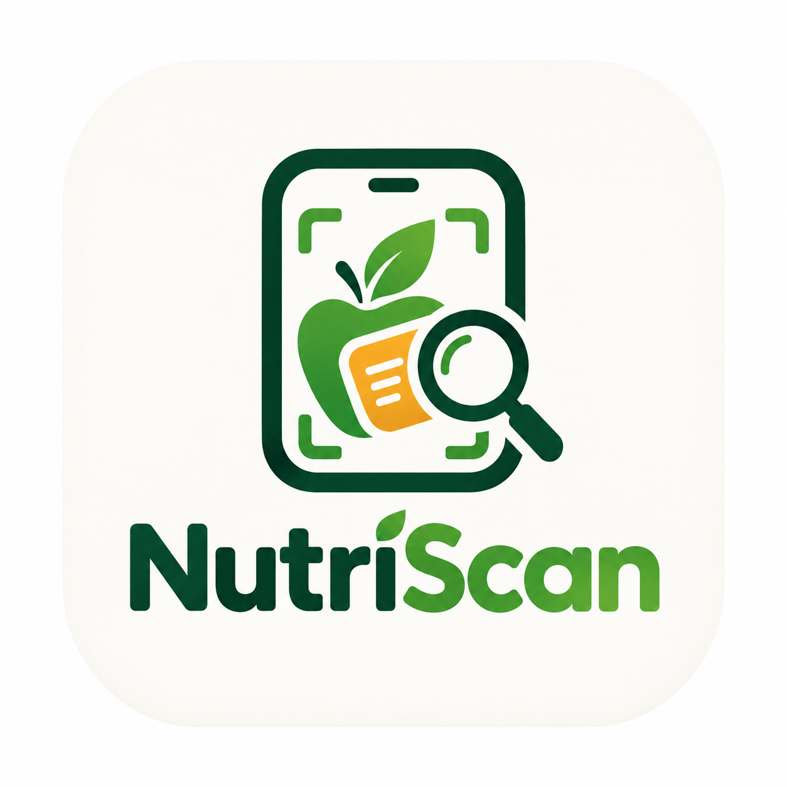

# NutriScan



**NutriScan is a bilingual English/Bangla personalized food intelligence and label-guide prototype for Bangladesh retail products.** It helps users scan or browse packaged products, inspect NQSS nutritional breakdowns and added-sugar teaspoon equivalents, compare food products side by side, explore ingredients and healthier alternatives, personalize health profiles and nutrition goals, and chat with **Nouri**, an integrated prototype nutrition assistant.

> **Prototype notice:** NutriScan is a frontend UI/UX demonstration application. NQSS scores, nutrition quantities, OCR label extractions, ingredient notes, package renders, premium subscription states, Nouri AI responses, and selected evidence states are local prototype values. They are not medical advice, laboratory results, halal certification, official product assessments, or a substitute for reading the current package label.

---

## What the app does

### Core & Upgraded Features

- **Onboarding & Simulated Auth (`/onboarding`)**: 3-step welcome flow introducing NutriScan's capabilities alongside a simulated Sign In / Register / Demo Login screen.
- **5-Tab Navigation**: Quick access across **Home**, **Discover**, an elevated center **Scan** button, **Nouri**, and **Profile** (while keeping utility routes like History, NutriFacts, Community, Contribute, and Support accessible from the Profile hub).
- **Enhanced Home (`/`)**: Time-aware personalized greeting, animated barcode scan card, quick search bar into Discover, category tiles (`Food`, `Personal care`, `Home care`), daily tip card, horizontal recent scans list, and catalog highlights.
- **Barcode & Simulated OCR Scanner (`/scan`)**:
  - **Barcode tab**: Native Expo Camera scanner, manual barcode lookup (supporting English and Bangla digits), and a web-only mock-camera mode for Expo Web Preview.
  - **Nutrition Label tab**: Simulated OCR camera capture with extraction state, sample label presets, editable nutrition fields, and an instant NQSS score estimator.
- **Product Details & NQSS (`/product/[id]`)**:
  - Category-aware layouts for **Food** (weighted NQSS `ScoreRing`, factor progress bars, `Per Serving` / `Per 100g` preview tabs), **Personal Care** (evidence summary), and **Home Care** (use-label & precaution summary).
  - **Added Sugar Teaspoon Indicator**: Automatically converts grams of added sugar (`4 g sugar = 1 teaspoon`) and displays a teaspoon icon and equivalent count right beside the added sugar amount.
  - Expandable ingredient rows with allergen flags, **Better Alternatives**, **Add to Compare** button, **Ask Nouri** shortcut, local like/dislike reaction counters, and source/evidence notes.
- **Compare Products (`/compare`)**:
  - Accessible from **Product Details** (*Add to Compare*) and **Profile → Features → Compare Products**.
  - Searchable two-slot picker to compare any two food products from the catalog side by side, with slot swap and quick-compare presets.
  - Displays **NQSS scores & weighted factor breakdown**, **nutritional comparison** (energy, added sugar in grams and teaspoons, sodium, protein, dietary fiber, and declared fats) with green indicators highlighting stronger values, **ingredients & additives comparison** with allergen and personal-allergy alerts, and a **Nouri AI comparison summary**.
- **Nouri AI Nutrition Assistant (`/nouri`)**:
  - Context-aware bilingual mock assistant with health-profile awareness indicator, contextual suggested questions, interactive product/action cards, typing indicator, and persistent local chat history.
- **My Account & Personalized Health Hub (`/profile` & `/account/*`)**:
  - **Health Profile (`/account/health-profile`)**: Manage personal info, health conditions, dietary restrictions, food allergies, and food intolerances with multi-select chips **plus manual custom entry** under each category.
  - **Nutrition Goals (`/account/nutrition-goals`)**: Choose from 10 preset bilingual nutrition goals **or add custom manual goals**.
  - **Preferences (`/account/preferences`)**, **Premium Demo (`/account/premium`)**, **Expiry Reminders (`/account/expiry-reminders`)**, **Personalized Tips (`/account/tips`)**, and **Settings (`/account/settings`)**.
- **Ingredient Explainer (`/ingredient/[id]`)**: 15-entry bilingual local ingredient reference with concern-level pills, allergen warnings, search mode (`/ingredient/search`), and matching catalog products.
- **Safety & Catalog Filters**:
  - **Halal Mode**: Shows only products with linked `halalEvidence` (package mark or certificate record).
  - **Child Safe Mode**: Filters out food products scoring below `60/100` in Discover and the Compare product picker.
- **Bilingual & Theme Support**: Instant switching between **English** and **বাংলা** (`Noto Sans Bengali`) and between **Light** and **Dark** appearances.

---

## Catalog coverage

The local prototype catalog ([`lib/nutriscan-data.ts`](lib/nutriscan-data.ts)) currently includes **26 Bangladesh-focused retail products** across three categories:

### Food (16 products)

- **7 primary food records**: PRAN Frooto Mango Drink, Radhuni Chilli Powder, Olympic Energy Plus Biscuits, Ispahani Mirzapore Tea, PRAN Mr. Noodles Spicy Tomato, Bombay Sweets Potato Crackers, and Olympic Tip Crispy Salted Biscuits.
- **9 same-family Better Alternatives**: Three higher-scoring (`> 60`) alternatives each for `mango-drink` (MangoField, AamRush, TropiDrop), `instant-noodles` (DailyCup, Cocora, NoodleCraft), and `potato-snack` (SunCrisp, CrunchBay, GoldenRoot).

Food records include weighted prototype NQSS scores (`60%` nutrition profile, `30%` ingredients & additives, `10%` label transparency), nutrition rows, ingredient explanations, and Better Alternatives when applicable. NQSS scores are prototype demonstrations and not a validated medical or nutritional standard.

### Personal care (5 products)

- Meril Petroleum Jelly, Keya Beauty Soap, Lux Soft Touch Beauty Soap, Sunsilk Black Shine Shampoo, and Dettol Original Handwash.

Personal-care records intentionally use an **evidence summary** rather than a food-style health score, focusing on ingredient disclosure, variant context, directions, and label verification.

### Home care (5 products)

- Vim Dishwashing Liquid, Wheel Washing Powder, Rin Power Bright Detergent, Harpic Power Plus Toilet Cleaner, and ACI Aerosol Insect Killer.

Home-care records use a **use-label summary** with directions, precautions, and verification notes. Cleaning products should always be used according to current package instructions and never mixed unless explicitly stated on the label.

---

## Main screens & routes

| Route | Purpose |
|---|---|
| `/` | Enhanced Home screen with greeting, animated scan card, quick search, daily tip, recent scans, and catalog highlights |
| `/discover` | Searchable product catalog with category filters, Halal Mode awareness, and Child Safe Mode filtering |
| `/scan` | Barcode scanner modal (camera, manual entry, web mock-camera) and simulated OCR Nutrition Label scanner |
| `/nouri` | Nouri AI Nutrition Assistant chat interface with health-profile context and suggested questions |
| `/profile` | My Account hub linking to health profile, goals, preferences, Compare Products, reminders, tips, and settings |
| `/compare` | Side-by-side comparison of any two food products (NQSS, nutrients + sugar teaspoons, ingredients, AI summary) |
| `/product/[id]` | Product details, NQSS ring & factor bars, sugar teaspoon badges, expandable ingredients, Better Alternatives, and Add to Compare |
| `/ingredient/[id]` | Ingredient explainer detail and searchable ingredient guide (`/ingredient/search`) |
| `/onboarding` | 3-step welcome, feature overview, and simulated Sign In / Register flow |
| `/account/health-profile` | Personal info + multi-select & manual-add chips for conditions, restrictions, allergies, and intolerances |
| `/account/nutrition-goals` | 10 preset nutrition goals + custom manual goal entry |
| `/account/preferences` | Halal Mode, Child Safe Mode, language, appearance, and simulated notification preferences |
| `/account/premium` | Demo plan comparison (Free vs. Premium) and simulated activation flow |
| `/account/expiry-reminders` | Local product expiry date tracker with status pills (`Safe`, `Expiring Soon`, `Expired`) |
| `/account/tips` | Goal-matched nutrition tips and saved tips list |
| `/account/settings` | Language, theme, clear scan history, reset preferences, and prototype info |
| `/history` | Scan history and saved favorites |
| `/contribute` | Local product-contribution draft form (front/back photos + details) |
| `/community` | Demo contributor leaderboard |
| `/nutrifacts` | General nutrition & label education with WHO/credible source references |
| `/support` | Prototype project support information |

---

## Technology stack

- **Expo SDK 57** and **React Native 0.86**
- **Expo Router** for file-based navigation and typed routes
- **React 19** and **TypeScript**
- **React Native Web** for browser preview
- **Expo Camera** & **Expo Image Picker** for native scanning and local contribution photos
- **AsyncStorage** for local persistence (preferences, health profile, goals, favorites, history, expiry reminders, compare slots, and Nouri chat history)
- **TanStack Query** and **tRPC** for the application/server boundary
- **Express**, `tsx`, and `esbuild` for the server runtime
- **Drizzle ORM** with MySQL support for database schema and migrations
- **Vitest** for automated tests
- **Noto Sans Bengali** (`@expo-google-fonts/noto-sans-bengali`) for English/Bangla typography
- **NativeWind** and shared NutriScan UI primitives (`components/nutriscan-ui.tsx`) for consistent light/dark styling

---

## Project structure

```text
app/
  _layout.tsx                    Root providers, hydration, onboarding gate, and stack routes
  onboarding.tsx                 Welcome slides and simulated Sign In / Register flow
  scan.tsx                       Barcode scanner (native/manual/mock) and simulated OCR label tab
  compare.tsx                    Side-by-side food comparison screen
  product/[id].tsx               Product details, NQSS breakdown, sugar teaspoons, and Add to Compare
  ingredient/[id].tsx            Ingredient explainer and searchable ingredient guide
  (tabs)/
    _layout.tsx                  5-tab bar (Home, Discover, Scan FAB, Nouri, Profile) + hidden routes
    index.tsx                    Enhanced Home screen
    discover.tsx                 Searchable catalog with Halal & Child Safe filters
    scan-tab.tsx                 Scan FAB route handler opening /scan modal
    nouri.tsx                    Nouri AI Nutrition Assistant chat screen
    profile.tsx                  Profile hub & Features menu
    history.tsx                  Scan history & favorites
    contribute.tsx               Local product-contribution draft form
    community.tsx                Demo contributor leaderboard
    nutrifacts.tsx               Daily tips, myth vs. fact, and nutrition facts
    support.tsx                  Support information screen
    more.tsx                     Legacy More screen (hidden tab)
  account/
    health-profile.tsx           Personal & health profile editor with manual chip additions
    nutrition-goals.tsx          Preset & custom nutrition goals selector
    preferences.tsx              Halal Mode, Child Safe Mode, language, appearance, notifications
    premium.tsx                  Simulated Premium plan screen
    expiry-reminders.tsx         Local best-before date tracker
    tips.tsx                     Goal-personalized & saved tips
    settings.tsx                 App settings & local data reset
components/
  nutriscan-ui.tsx               Shared AppText, Screen, PageHeader, Card, Pill, ChipSelect, ScoreRing, TabSwitcher, etc.
lib/
  nutriscan-data.ts              26-product catalog, localization copy, Halal/Child Safe & Better Alternatives helpers
  nutriscan-state.tsx            NutriScanProvider and AsyncStorage persistence
  nutrition-utils.ts             Added-sugar teaspoon math, localized numbers, allergen/additive helpers
  comparison-engine.ts           Side-by-side nutrient/factor/ingredient engine & AI comparison summary generator
  nouri-engine.ts                Keyword-based bilingual Nouri mock response & suggested question engine
  nutrifacts.ts                  Daily tips, ingredient insights, and myth-vs-fact data
assets/
  images/                        Brand logo, NutriScan mark, and product images (with SOURCES.md)
drizzle/
  schema.ts                      Database schema
server/
  routers.ts                     tRPC/API routers and server operations
shared/
  types.ts                       Shared application types and constants
tests/
  *.test.ts                      Vitest test suites
plan.md                          Initial product & UX plan
TODO.md                          Project outcome checklist
```

---

## Getting started

### Requirements

- Node.js compatible with the project's Expo/TypeScript toolchain
- `pnpm` 9.x (`pnpm@9.12.0`)
- A supported Expo environment for native Android or iOS testing
- A configured database connection only if running Drizzle migrations or database-backed server features

### Install dependencies

```bash
pnpm install
```

### Start the development app

The standard development command starts both the API server and the Expo Web Preview:

```bash
pnpm dev
```

Fixed development ports:

- **Expo Web Preview**: `http://localhost:8081`
- **API server**: `http://localhost:3000`

To run only one side:

```bash
pnpm dev:metro     # Expo Web Preview on port 8081
pnpm dev:server    # API server on port 3000
```

### Run native targets

```bash
pnpm android
pnpm ios
```

Native barcode scanning requires a device or emulator with camera support and camera permission. Use the scanner's **Try mock camera** toggle in Expo Web Preview to test the camera UI without hardware.

### Database setup (optional)

If your environment provides a database configuration, generate and apply the Drizzle schema with:

```bash
pnpm db:push
```

All prototype features—catalog browsing, scanning, comparison, Nouri chat, health profile, nutrition goals, expiry reminders, favorites, and history—operate locally without requiring a live database.

---

## Quality checks

Run checks before committing or handing off changes:

```bash
pnpm check        # TypeScript check (tsc --noEmit)
pnpm lint         # Expo ESLint check
pnpm test         # Vitest suite (vitest run)
```

Additional scripts:

```bash
pnpm format       # Format the repository with Prettier
pnpm build        # Bundle the server into dist/
pnpm start        # Start the bundled production server
pnpm qr           # Generate the project QR helper output
```

> **Note:** `tests/cors.test.ts` binds a local loopback server during tests, and `tests/auth.logout.test.ts` may skip when external auth prerequisites are unavailable.

---

## State and privacy model

NutriScan stores prototype state locally on the device/browser via `AsyncStorage` (`nutriscan-prototype-state-v1`), including:

- Onboarding & simulated auth state (`isAuthenticated`, `hasCompletedOnboarding`, `demoAccount`)
- Health profile (`age`, `gender`, `country`, `healthConditions`, `dietaryRestrictions`, `foodAllergies`, `foodIntolerances`, `nutritionGoals`)
- Preferences (`language`, `appearance`, `halalMode`, `childSafeMode`, `isPremium`)
- User lists & activity (`history`, `favorites`, `submissions`, `productReactions`, `expiryReminders`, `savedTips`, `nouriHistory`, `compareIds`)

Do not enter sensitive personal or medical data into this prototype. It is not a production account, medical-record, dietary-prescription, or product-certification system.

---

## Better Alternatives & Compare logic

- **Better Alternatives** ([`lib/nutriscan-data.ts`](lib/nutriscan-data.ts)): Applies to food products scoring below `60` that belong to a `comparisonFamily` (`mango-drink`, `instant-noodles`, `potato-snack`), returning up to three different-brand products in the same family with scores strictly above `60` and higher than the current product.
- **Compare Products** ([`lib/comparison-engine.ts`](lib/comparison-engine.ts)): Compares any two food products side by side using their actual catalog NQSS scores, weighted factor scores, declared nutrients (including `4 g = 1 teaspoon` added-sugar conversion), ingredient/additive/allergen overlap, and a mock AI summary grounded in those values plus the user's `healthProfile`.

---

## Halal Mode & Child Safe Mode

- **Halal Mode** filters the catalog strictly by explicit `halalEvidence` fields (`package-mark` or certificate record) and never infers halal status from brand names, ingredients, or scores. It is not a halal certification.
- **Child Safe Mode** filters out food products with NQSS scores below `60/100` in Discover and the Compare product picker while keeping all hidden records intact when toggled off.

---

## Product images and provenance

Product imagery lives in [`assets/images/products/`](assets/images/products/). Some images are normalized references from public product listings, while alternative, personal-care, and home-care renders include generated prototype visuals. See [`assets/images/products/SOURCES.md`](assets/images/products/SOURCES.md) for provenance notes before any public or commercial distribution.

---

## Contributing

1. Create a feature branch.
2. Keep new UI text and product records bilingual using the `Localized` (`en`/`bn`) shape.
3. Preserve category separation: use `food`, `personalCare`, or `household`, and do not attach food NQSS scores to personal-care or home-care products.
4. Keep prototype boundaries explicit and avoid presenting demo scores, mock AI guidance, or generated visuals as official facts.
5. Run `pnpm check`, `pnpm lint`, and `pnpm test`, and update `TODO.md` when outcomes are completed.

---

## License and usage note

This repository is a prototype application. Product names, package visuals, scores, ingredients, and label details may be trademarks, fictional records, or demonstration content belonging to their respective owners. Confirm licensing, trademark, image, and data rights before using NutriScan outside a private prototype or educational environment.
